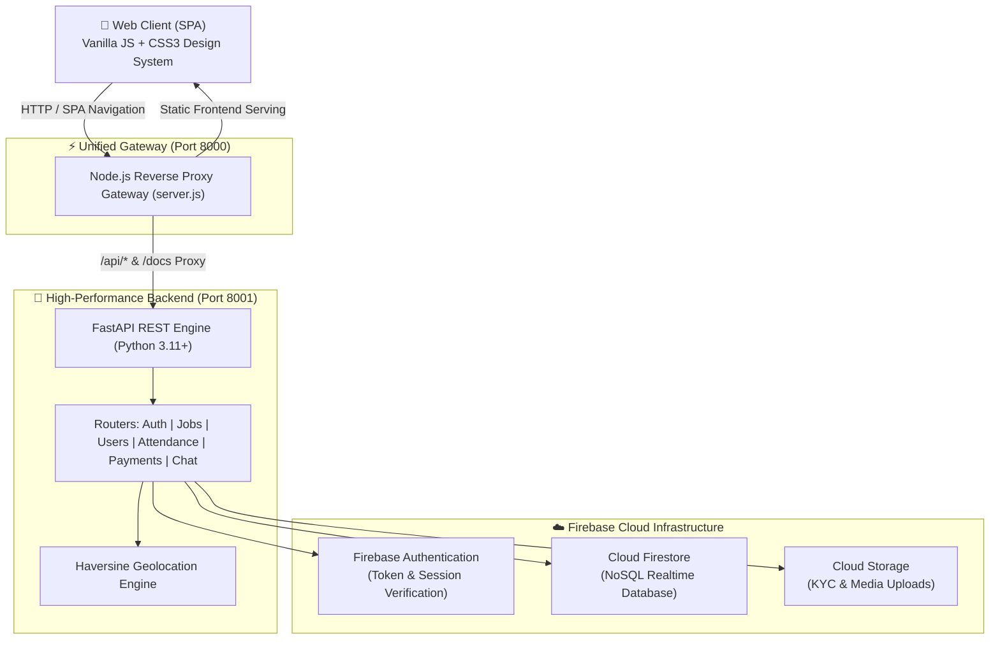

# 💼 DailyJob (कामसाथी)

<p align="center">
  
  
  
  
  
  
</p>

<p align="center">
  <b>🇮🇳 Empowering Blue-Collar & Daily Wage Workers with Transparent, Hyperlocal, and Tech-Driven Employment</b>
  <br />
  <i>स्थानीय काम और कामगारों का आधुनिक डिजिटल मंच | Connecting Local Employers with Verified Skilled Workers</i>
</p>

---

## 📖 Overview (परियोजना परिचय)

**DailyJob (कामसाथी)** is a next-generation hyperlocal workforce management and job matching platform specifically engineered for the unorganized blue-collar and daily-wage sector. It bridges the trust and proximity gap between local employers (contractors, homeowners, small businesses) and daily wage earners (masons, carpenters, electricians, plumbers, painters, helpers, etc.).

Equipped with **GPS Geofenced Attendance**, **Automated Wage Settlements**, **Real-time In-app Chat**, **Dispute Resolution**, and **Multi-lingual Support (Hindi & English)**, DailyJob brings accountability, dignity, and efficiency to informal labor markets.

---

## ✨ Key Features (मुख्य विशेषताएं)

### 👷 For Workers (कामगारों के लिए)
- **⚡ Dual-Mode Adaptive Profiles:** Seamless profile creation tailored to specific trades, skills, daily wage expectations, and verification status.
- **📍 Hyperlocal Job Matching:** Find high-paying work within walking distance or customizable radius (1 km – 25 km) using the Haversine distance engine.
- **⏱️ Geofenced GPS Attendance:** Check-in and check-out verified through device geolocation to guarantee transparent proof-of-work.
- **💰 Transparent Daily Ledger:** Live tracking of daily wages, approved payouts, bonuses, and payment receipts.
- **🛡️ Safety & SOS:** Emergency distress beacon, SOS alerts, and emergency contact notifications.
- **🌐 Bilingual UI:** Full accessibility in Hindi and English with intuitive vernacular iconography.

### 🏢 For Employers & Contractors (नियोक्ताओं के लिए)
- **📢 1-Click Job Posting:** Instant job requirements publishing with skill criteria, timing, wage type (Daily/Hourly/Lump-sum), and precise GPS job coordinates.
- **👥 Candidate Tracking System (ATS):** End-to-end applicant lifecycle: `APPLIED` ➔ `SHORTLISTED` ➔ `HIRED` ➔ `COMPLETED`.
- **📊 Real-time Attendance Roster:** Monitor worker check-ins with tamper-resistant distance validation.
- **⚖️ Built-in Dispute Resolution:** Raise and settle wage discrepancies or quality issues with full administrative audit trails.
- **💬 Direct In-App Chat:** Real-time job-specific messaging between employer and worker.

---

## 🏗️ System Architecture



---

## 🛠️ Technology Stack

| Layer | Technologies Used |
| :--- | :--- |
| **Frontend** | HTML5, Vanilla JavaScript (ES6+ Modular SPA Architecture), Custom CSS3 Design System (Glassmorphic, Responsive, Dark/Light palettes) |
| **Backend** | Python 3.11+, FastAPI (Asynchronous REST API), Uvicorn ASGI Server, Pydantic v2 |
| **Gateway & Server** | Node.js Express / Native HTTP Reverse Proxy (`server.js`) |
| **Database & Auth** | Google Firebase Firestore (NoSQL), Firebase Authentication, Firebase Admin SDK |
| **Location Services**| Browser Geolocation API + Backend Haversine Formula Distance Computation |
| **Testing** | Node.js Test Suite (6 Integration test suites) + Pytest (26 Backend Unit/Integration tests) |

---

## 📂 Project Directory Structure

```text
DailyJob/
├── RUN.bat                  # 🚀 1-Click Unified Interactive Launcher
├── RUN.md                   # Detailed setup and operational documentation
├── server.js                # Node.js Frontend server + Gateway reverse proxy
├── index.html               # SPA Entrypoint
├── css/                     # Tailored CSS3 stylesheets
│   ├── main.css             # Core design system & theme variables
│   ├── components.css       # Modals, cards, badges, buttons
│   └── responsive.css       # Mobile & tablet layout optimizations
├── js/                      # Frontend architecture
│   ├── app.js               # Application coordinator
│   ├── router.js            # Client-side hash routing
│   ├── authService.js       # Authentication state machine
│   ├── translations.js      # Hindi & English i18n dictionary
│   └── views/               # Dynamic View Controllers (Jobs, Profile, Workers, etc.)
├── backend/                 # FastAPI Backend Platform
│   ├── requirements.txt     # Python dependencies
│   ├── app/
│   │   ├── main.py          # FastAPI application & middleware
│   │   ├── api/             # REST API routes (Auth, Jobs, Attendance, etc.)
│   │   ├── models/          # Domain data models
│   │   ├── schemas/         # Pydantic validation schemas
│   │   ├── services/        # Business logic & algorithms
│   │   ├── repositories/    # Firestore data access layer
│   │   ├── firebase/        # Firebase client & credential wrappers
│   │   └── utils/           # Geo-distance, validators, helpers
│   └── tests/               # Pytest automated test suites
└── tests/                   # End-to-end JavaScript test suites
```

---

## ⚡ Quick Start (शुरुआत कैसे करें)

### 🎯 The 1-Click Launcher (Recommended for Windows)

Simply double-click `RUN.bat` or run from your terminal:

```powershell
.\RUN.bat
```

Select option **`1`** to automatically:
1. Boot the **FastAPI Backend** on `http://localhost:8001`.
2. Boot the **Node.js Frontend & Reverse Proxy** on `http://localhost:8000`.
3. Auto-launch the application directly in your default browser!

---

### 💻 Manual Startup

#### 1. Backend Setup (FastAPI)
```bash
cd backend
python -m venv venv
# Windows:
venv\Scripts\activate
# Linux/macOS:
source venv/bin/activate

pip install -r requirements.txt
python -m uvicorn app.main:app --host 0.0.0.0 --port 8001 --reload
```

#### 2. Frontend Setup (Node.js)
```bash
# In the root directory:
npm install
node server.js
```

Open **`http://localhost:8000`** in your browser.

---

## 🌐 Unified Gateway & API Endpoints

Through the integrated reverse proxy, everything is accessible on a single unified port:

| Interface | URL | Description |
| :--- | :--- | :--- |
| **Web Application** | `http://localhost:8000/` | Full Single Page Application UI |
| **Swagger Interactive Docs** | `http://localhost:8000/docs` | Live API testbed & documentation |
| **ReDoc Documentation** | `http://localhost:8000/redoc` | Formatted API specifications |
| **Backend Health Check** | `http://localhost:8000/api/backend-status` | Live latency & operational diagnostic |

---

## 🧪 Running Tests (स्वचालित परीक्षण)

### Run All Backend Tests (Pytest)
```bash
cd backend
pytest -v
```
*(Includes 26 comprehensive tests covering Auth, Attendance, Geofencing, Payments, Jobs, and Disputes).*

### Run All Frontend & Profile Tests
```bash
npm test
```

---

## 🔒 Security & Privacy

- **Isolated Credentials:** Sensitive tokens, Firebase Service Account Keys, and `.env` secrets are strictly protected and excluded from source control.
- **Geofence Verification:** GPS spoofing prevention with distance validation checks.
- **Role-Based Access Control:** Strict authorization barriers between Employer, Worker, and Administrator operations.

---

## 👨‍💻 Author & Contribution

Developed with ❤️ by **[tushar-kumar-code](https://github.com/tushar-kumar-code)**.

Contributions, feature suggestions, and feedback are welcome! Feel free to open an Issue or submit a Pull Request.

---

<p align="center">
  <b>⭐ If you find this project impactful, consider starring this repository! ⭐</b>
</p>
